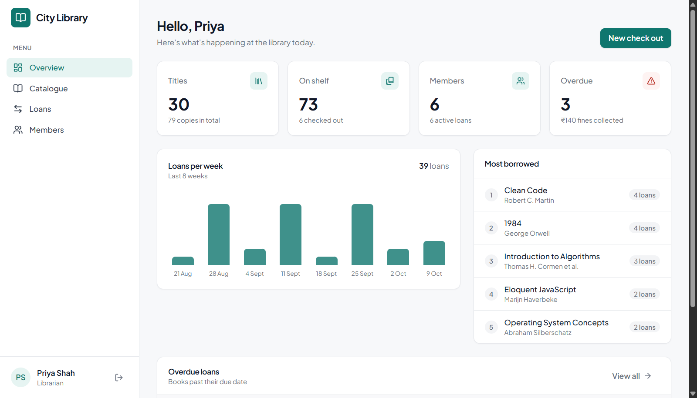
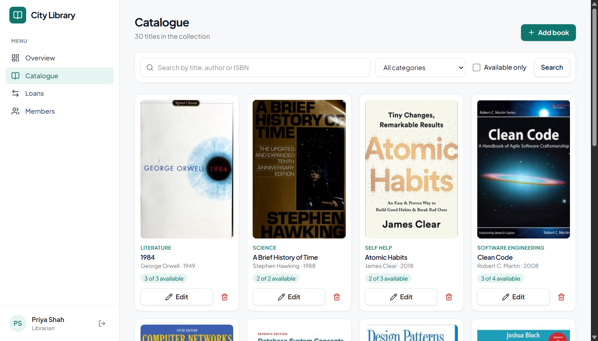
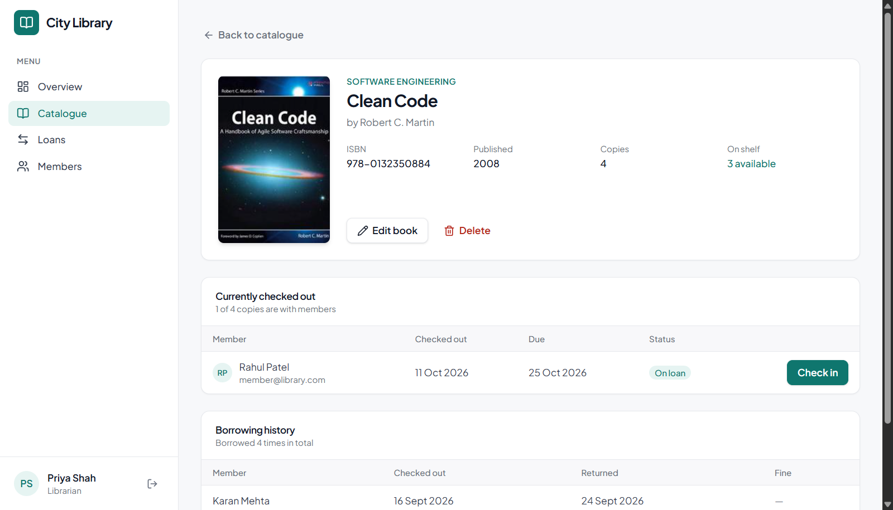

# Library Management System

[](https://github.com/SuhaibMalam/Library-Management/actions/workflows/test.yml)

A full-stack web app for running a small library: a searchable catalogue, check out and check in with due dates, renewals and late fines, and separate views for admins, librarians and members.

**Live demo:** _coming soon_

| Role | Email | Password |
|---|---|---|
| Admin | `admin@library.com` | `password123` |
| Librarian | `librarian@library.com` | `password123` |
| Member | `member@library.com` | `password123` |

> The API runs on a free hosting tier that sleeps when idle, so the first sign-in can take up to a minute.



| Catalogue | Book details |
|---|---|
|  |  |

## Features

**Members**
- Search the catalogue by title, author or ISBN, filter by category or availability
- Borrow books (up to 3 at a time) for 14 days, renew twice, return online
- See who currently has a book and when the next copy is due back

**Librarians**
- Add, edit and remove books; copy counts stay consistent with books on loan
- Check out books to members and check them in, with fines of ₹10 per full day late
- Overview with stock, overdue loans, loans per week and the most borrowed titles
- Per-book page with current borrowers and full borrowing history

**Admins**
- Everything a librarian can do
- Manage user accounts and promote members to librarian or admin

## Tech stack

| Layer | Technology |
|---|---|
| Frontend | React 19, React Router, Tailwind CSS, Vite |
| Backend | Node.js, Express 5 |
| Database | MySQL 8 with Sequelize ORM |
| Auth | JWT (7-day tokens), bcrypt password hashing |
| Testing | Node test runner + Supertest against a real MySQL database, GitHub Actions |
| Hosting | Vercel (client), Render (API), Aiven (MySQL) |

## How it works

```
React app (Vercel)  ──HTTPS/JSON──>  Express API (Render)  ──TLS──>  MySQL (Aiven)
     JWT in header                    auth + role checks
```

A few decisions worth pointing out:

- **No double-booking the last copy.** Borrowing runs in a database transaction that locks the book row (`SELECT … FOR UPDATE`), so two requests at the same moment cannot both take the final copy.
- **Roles are checked on the server, not just hidden in the UI.** Every route goes through `requireAuth` and `requireRole`. Public sign-up always creates a member, whatever the request body says.
- **The user is reloaded on every request**, so a changed role or a deleted account takes effect immediately instead of when the token expires.
- **Integrity in the database.** Unique email and ISBN, and foreign keys with `RESTRICT`, so a book or user with borrowing history cannot be deleted.
- **Fines count full days only**, so returning a book a few hours late is not charged.

## API

All routes are under `/api` and, apart from auth and health, need an `Authorization: Bearer <token>` header.

| Method | Route | Access |
|---|---|---|
| POST | `/auth/register`, `/auth/login` | Public |
| GET | `/auth/me` | Signed in |
| GET | `/books?q=&category=&available=&page=` | Signed in |
| GET | `/books/:id` | Signed in |
| POST, PUT, DELETE | `/books`, `/books/:id` | Librarian, admin |
| GET | `/loans?status=active\|overdue\|returned&bookId=` | Own loans for members, all for staff |
| POST | `/loans` | Members borrow for themselves, staff for any member |
| PATCH | `/loans/:id/renew`, `/loans/:id/return` | Borrower or staff |
| GET | `/users?q=&role=` | Librarian (members only), admin |
| PATCH, DELETE | `/users/:id/role`, `/users/:id` | Admin |
| GET | `/stats` | Librarian, admin |
| GET | `/health` | Public |

## Running locally

Requirements: Node.js 20+ and MySQL 8.

```bash
git clone https://github.com/SuhaibMalam/Library-Management.git
cd Library-Management
npm run install:all
```

Create two databases, `library_dev` and `library_test`, then copy `server/.env.example` to `server/.env` and fill in your MySQL user and password.

```bash
npm run seed      # sample books, users and loans
npm run server    # API on http://localhost:5000
npm run client    # app on http://localhost:5173 (in a second terminal)
npm test          # API tests (uses library_test)
```

## Project structure

```
server/
  src/
    app.js          Express app, routes, error handling
    auth.js         JWT, requireAuth, requireRole
    models.js       User, Book, Loan and business constants
    routes/         auth, books, loans, users, stats
    seed.js         sample data
  test/api.test.js
client/
  src/
    api.js          fetch wrapper
    AuthContext.jsx
    components/     layout and shared UI
    pages/          Login, Register, Dashboard, Books, BookDetail, BookForm, Loans, Users
```
